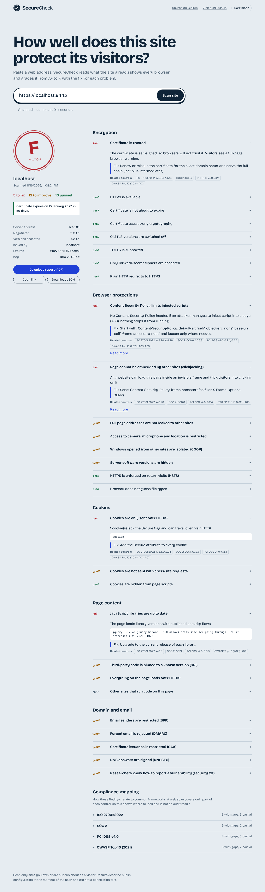

# SecureCheck

Paste a web address, get a security grade from A+ to F with the fix for every problem found.

SecureCheck is a passive website security scanner. It reads only what a site already shows every browser (its TLS handshake, response headers, cookies and public DNS records) and turns that into a plain-language report.



*Sample report against a deliberately weak local test server.*

## What it checks

| Area | Checks |
| --- | --- |
| Encryption | HTTPS available, TLS 1.0 / 1.1 / 1.2 / 1.3 support, forward-secret key exchange only, certificate trust, expiry, key size and signature algorithm, HTTP to HTTPS redirect |
| Browser protections | HSTS, Content Security Policy from the header or a `<meta>` tag (including `unsafe-inline`, `unsafe-eval`, wildcards), clickjacking defence, `nosniff`, Referrer-Policy, Permissions-Policy, Cross-Origin-Opener-Policy, obsolete `X-XSS-Protection`, CORS origin reflection, server version disclosure |
| Cookies | `Secure`, `HttpOnly`, `SameSite` on every cookie set |
| Page content | Third-party scripts and stylesheets without Subresource Integrity, mixed content and insecure form targets, outdated jQuery / Bootstrap / AngularJS versions, inventory of third-party script hosts |
| Domain and email | SPF, DMARC, DNSSEC, CAA, MTA-STS, `security.txt` |

Each finding carries a status, a severity, the raw evidence, a fix and a score penalty. The full report can be downloaded as a PDF or as JSON. The score starts at 100; a failed check costs its full penalty, a warning half. An untrusted certificate caps the score at 45 and missing HTTPS caps it at 30.

## Compliance mapping

Every finding lists the controls it relates to in four frameworks, and the report ends with a per-framework summary showing which controls have gaps.

| Framework | Examples of mapped controls |
| --- | --- |
| ISO 27001:2022 (Annex A) | A.8.24 Use of cryptography, A.8.26 Application security requirements, A.8.9 Configuration management, A.5.21 ICT supply chain |
| SOC 2 (Trust Services Criteria) | CC6.7 Transmission protection, CC6.6 External threats, CC7.1 Vulnerability detection, CC9.2 Vendor risk |
| PCI DSS v4.0 | 4.2.1 Strong cryptography in transit, 6.2.4 Common attack prevention, 6.4.3 Browser script integrity, 5.4.1 Anti-phishing |
| OWASP Top 10 (2021) | A02 Cryptographic Failures, A05 Security Misconfiguration, A06 Vulnerable and Outdated Components, A08 Integrity Failures |

The mapping lives in `app/compliance.py`. It is indicative: a passive web scan shows evidence for or against part of a control and is never an audit result on its own.

## The scanner is the interesting attack surface

A service that fetches URLs on behalf of strangers is a classic Server-Side Request Forgery (SSRF) target. Most of the engineering here went into making the scanner safe to expose publicly.

| Threat | Defence | Where |
| --- | --- | --- |
| Scan `http://169.254.169.254/` or `localhost` to reach cloud metadata or internal services | Hostnames only; every resolved address must be globally routable. Private, loopback, link-local, CGNAT, multicast, IPv4-mapped IPv6 and 6to4 ranges are refused | `app/netguard.py` |
| Disguised IPs such as `2130706433`, `0x7f.0.0.1`, `127.1` | Detected with `inet_aton` and rejected before DNS | `app/netguard.py` |
| DNS rebinding: name resolves to a public IP at check time and an internal IP at connect time | The name is resolved once and the socket connects to that validated IP; SNI and `Host` still carry the hostname | `app/fetch.py` |
| A domain with one public and one internal A record | Rejected if any record is non-public | `app/netguard.py` |
| Redirect from a public site to an internal one | Each redirect hop goes through the same validation; five hops at most | `app/fetch.py` |
| Port scanning through the scanner | Ports 80 and 443 only | `app/netguard.py` |
| Other URL schemes (`file://`, `gopher://`) and credentials in URLs | Rejected | `app/netguard.py` |
| Stored or reflected XSS through hostile header values shown in the report | The front end never uses `innerHTML`; the page is served with `script-src 'self'` and no inline script | `static/app.js`, `app/main.py` |
| Resource exhaustion | Per-address and global rate limits, a concurrency cap, 8 second timeouts, 512 KB body cap, five minute result cache | `app/main.py`, `app/fetch.py` |
| Hostile values in the PDF report | The report is built only from the server's own scan result, never from data the client sends, and every value is escaped before it is placed | `app/report.py`, `app/main.py` |
| Hostile page markup | Pages are parsed with the standard library parser, capped at 512 KB and 5,000 tags, and nothing in them is executed | `app/checks/content.py` |
| Leaking internals in errors | Unexpected errors are logged server-side and replaced with a generic message | `app/main.py` |
| Container compromise | Runs as a non-root user | `Dockerfile` |

The app also sends the headers it checks for, so it scores well when pointed at itself.

## Run it locally

Requires Python 3.11 or newer.

```bash
python -m venv .venv
.venv\Scripts\activate          # Windows
# source .venv/bin/activate     # macOS / Linux
pip install -r requirements-dev.txt

uvicorn app.main:app --reload
```

Open http://127.0.0.1:8000 and scan a site.

Command line:

```bash
python -m app.cli example.com          # readable report
python -m app.cli example.com --json   # full JSON
```

The CLI exits with code 1 for a grade of D or F, so it can fail a CI job.

Tests:

```bash
python -m pytest -q
```

The suite includes an end-to-end test that starts a local HTTPS server with a self-signed certificate and deliberately weak headers, then checks that the scanner reports each weakness.

## API

```
POST /api/scan
Content-Type: application/json

{"url": "example.com"}
```

Returns the grade, score, TLS summary and the list of findings. `POST /api/report` takes the same body and returns the report as a PDF. Errors return `{"error": "..."}` with status 400 (target refused), 429 (rate limited) or 503 (busy).

## Deploy

**Docker**

```bash
docker build -t securecheck .
docker run -p 8000:8000 securecheck
```

**Render (free tier)**

1. Push this repository to GitHub.
2. In Render choose New > Blueprint and select the repository. `render.yaml` does the rest.
3. To serve it from your own domain, add a custom domain in Render (for example `scan.akhilkulal.in`) and create the CNAME record it shows you.

**Serve it under a path on your own site**

The front end uses relative URLs, so it works at any path. `deploy/cloudflare-worker.js` is a small Cloudflare Worker that serves the hosted scanner at `akhilkulal.in/project/securecheck/`; setup steps are at the top of that file.

Configuration is through environment variables:

| Variable | Default | Meaning |
| --- | --- | --- |
| `SECURECHECK_RATE_PER_IP` | 10 | Scans per minute per client address |
| `SECURECHECK_RATE_GLOBAL` | 60 | Scans per minute in total |
| `SECURECHECK_MAX_CONCURRENT` | 8 | Scans running at once |

Never set `SECURECHECK_ALLOW_PRIVATE` in production. It exists only so the test suite can scan a local server, and it switches the SSRF protection off.

## Known limits

- TLS 1.0 and 1.1 can only be probed if the OpenSSL build on the host still supports them. When it does not, the report says the versions could not be tested instead of guessing.
- The per-address rate limit trusts the `X-Forwarded-For` header set by the hosting proxy. A client that can reach the app directly could spoof it; the global limit is the backstop.
- Rate limits and the cache are in memory, so they are per instance.
- SPF and DMARC are looked up by walking up the hostname instead of using the Public Suffix List.
- Outdated libraries are recognised from script file names only, so bundled copies are missed.
- Only the one page requested is examined. Headers can differ on other paths.

## Ideas for later

- Cipher suite enumeration and OCSP stapling check
- Scheduled re-scans with Slack alerts when a grade drops
- HSTS preload list lookup

## Licence

MIT. The bundled Bricolage Grotesque font is under the SIL Open Font License (`static/fonts/OFL.txt`).
